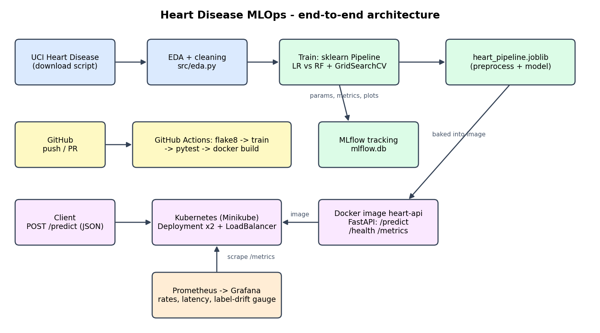
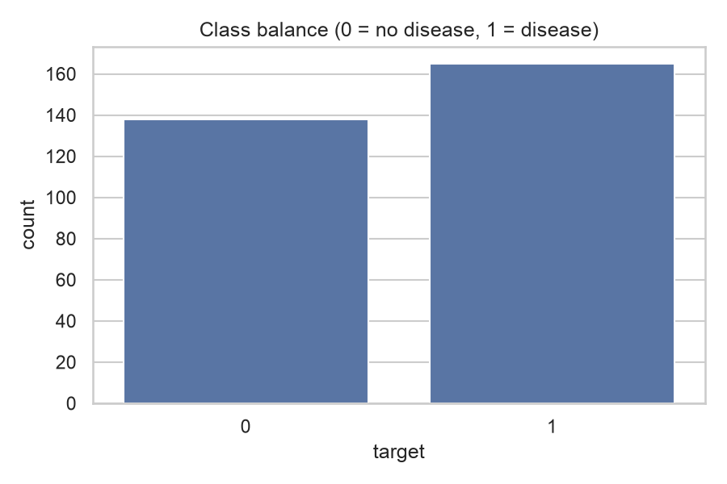
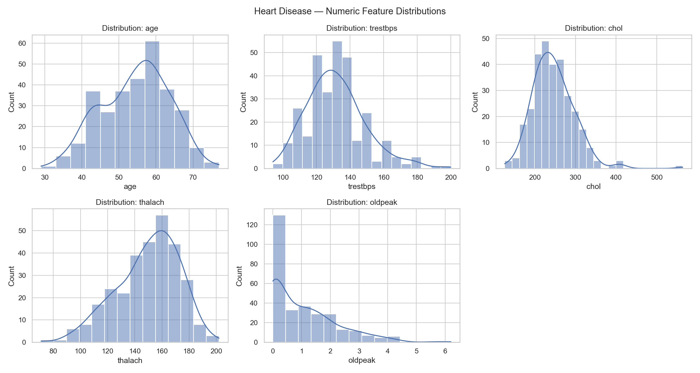
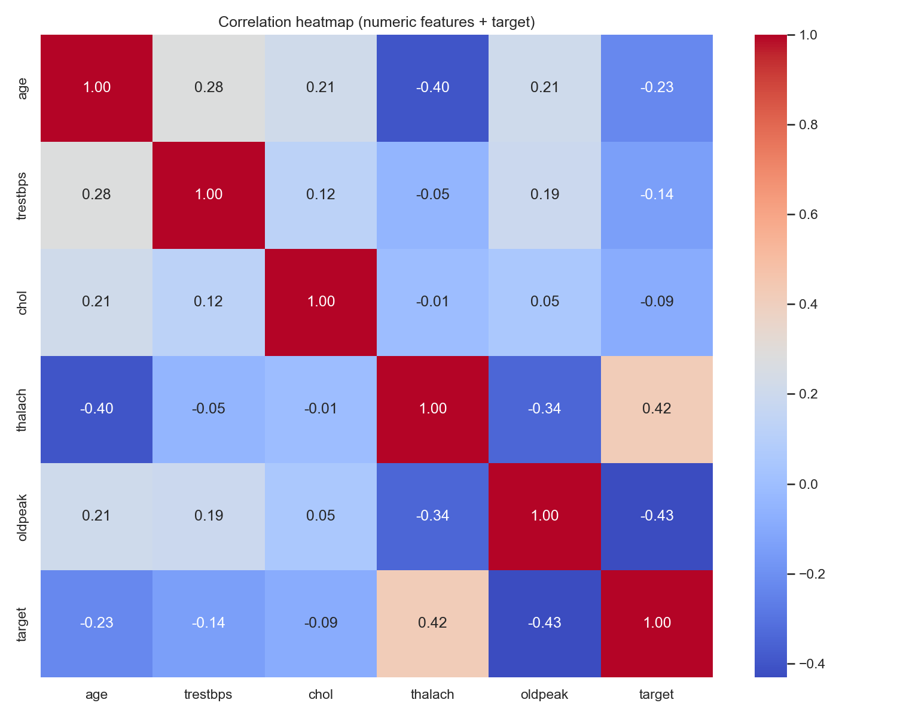
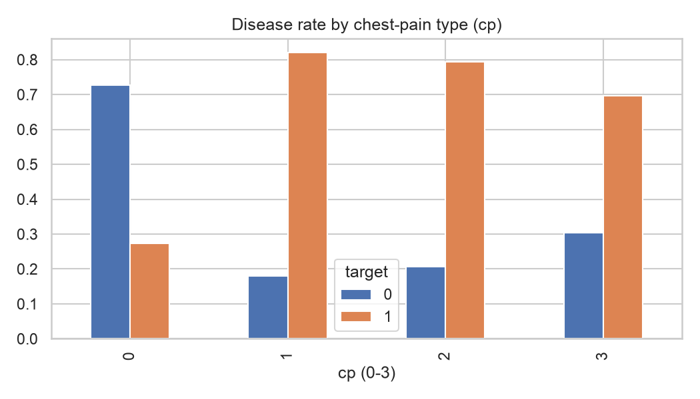
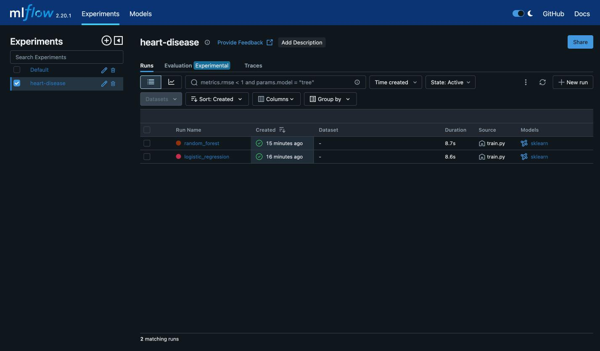
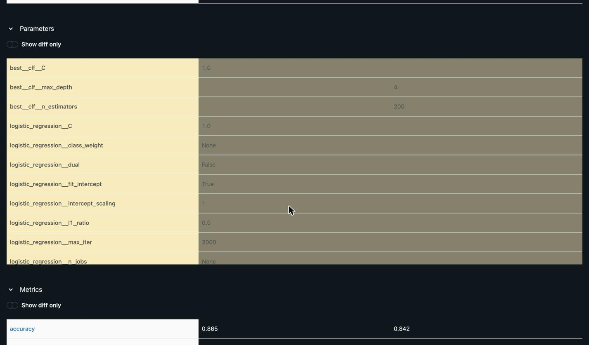
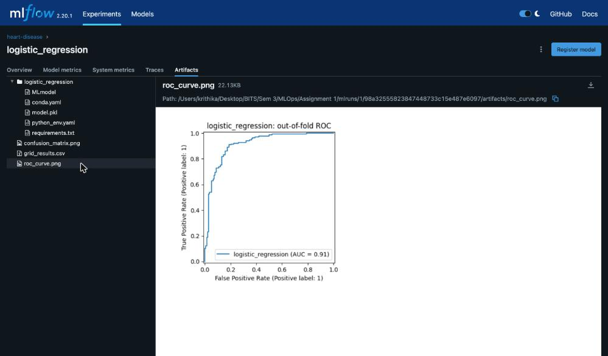
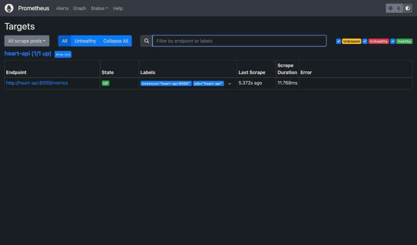
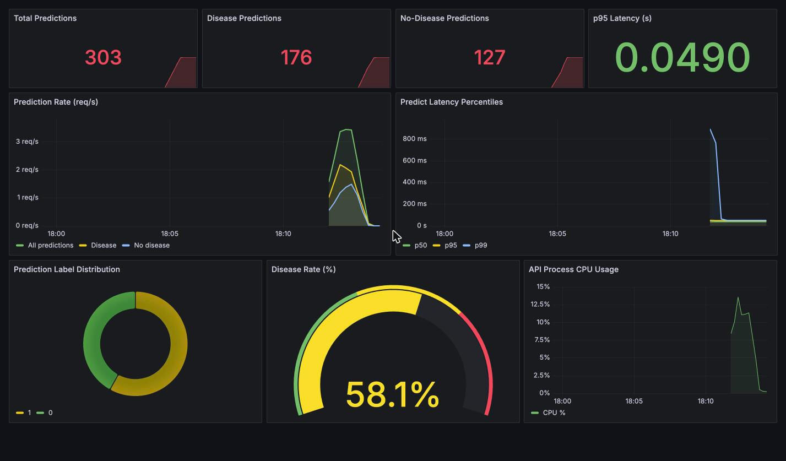

**Student ID:** 2025ae05082 &nbsp;·&nbsp; **Code repository:** <https://github.com/krxthx/2025ae05082-MLOps-Assignment-1>

**Problem.** Predict the presence of heart disease (binary) from 13 clinical features of the UCI Heart Disease
(Cleveland) dataset, 303 patients, and ship the model as a containerised, monitored, Kubernetes-deployed API with
experiment tracking and CI.

**Stack.** scikit-learn pipelines · MLflow · FastAPI · pytest · flake8 · GitHub Actions · Docker · Kubernetes
(Minikube) · Prometheus · Grafana.



*Figure 1 — Architecture. Data is downloaded and cleaned, a single scikit-learn `Pipeline` (preprocessing + classifier)
is tuned and cross-validated with every run logged to MLflow, and the winning pipeline is serialised and baked into
a Docker image. The image is deployed to Kubernetes and scraped by Prometheus, with Grafana on top. GitHub Actions
re-runs lint → train → test → docker build on every push.*

# 1. Setup and installation

Everything runs from a clean checkout using only `requirements.txt` (pinned versions). Python 3.11–3.13 tested.

```bash
git clone https://github.com/krxthx/2025ae05082-MLOps-Assignment-1.git && cd 2025ae05082-MLOps-Assignment-1
python -m venv .venv && source .venv/bin/activate
pip install -r requirements.txt
python src/data_download.py      # -> data/heart.csv (303 x 14)
python src/eda.py                # -> screenshots/eda_*.png
python src/train.py              # tuning + 5-fold CV + MLflow -> models/heart_pipeline.joblib
pytest -q                        # 7 tests
python -m flake8 src tests --max-line-length=120 --extend-ignore=E203,W503
uvicorn src.app:app --port 8000  # /health  /predict  /metrics
python src/inference.py --url http://localhost:8000
mlflow ui --backend-store-uri sqlite:///mlflow.db   # inspect runs, plots, artifacts
```

`requirements-serve.txt` is a slim subset (no MLflow / matplotlib / seaborn) used for the serving image.
`mlflow.db` is generated by `train.py` and intentionally not committed (see §6, lesson 2).

**Repository layout**

| Path | Purpose |
|---|---|
| `src/` | `data_download.py`, `eda.py`, `preprocessing.py`, `train.py`, `app.py` (API), `inference.py`, `make_architecture.py` |
| `tests/test_all.py` | unit + API tests (pytest) |
| `.github/workflows/ci.yml` | lint → train → test → docker build → upload artifacts |
| `Dockerfile`, `docker-compose.yml` | serving image; API + Prometheus + Grafana stack |
| `k8s/` | `deployment.yaml` (2 replicas, probes, limits), `service.yaml` (LoadBalancer) |
| `monitoring/` | Prometheus scrape config + auto-provisioned Grafana datasource and dashboard |
| `data/`, `models/`, `screenshots/`, `notebooks/` | cleaned dataset, saved model + metrics, evidence, EDA/training notebook |

# 2. Data acquisition and EDA (Task 1)

**Acquisition.** `src/data_download.py` downloads the UCI Heart Disease data (a clean CSV mirror first, then the
original `processed.cleveland.data` with `?` → NaN handling and the 0–4 target binarised to 0/1), caches it as
`data/heart.csv`, and fails loudly if no source is reachable. Columns: `age sex cp trestbps chol fbs restecg thalach
exang oldpeak slope ca thal` plus `target`.

**Cleaning.** The 303-row snapshot has no missing values and no duplicates (checked in `eda.py`). Even so, the
pipeline imputes (median for numeric, most-frequent for categorical) so the API remains robust to partial input at
serving time. `ca` and `thal` are kept as categorical codes.

**EDA findings** (all figures are produced by `python src/eda.py`):

{width=55%}

*Class balance: 165 disease (54.5 %) vs 138 healthy (45.5 %). Mild imbalance, so no resampling; stratified CV is used
everywhere and recall/precision are reported alongside accuracy.*



*Histograms: `chol` is right-skewed (max 564) and `oldpeak` is zero-inflated, which motivates `StandardScaler` on the
numeric block rather than raw values.*

{width=75%}

*Correlation heatmap: `thalach` (max heart rate) is negatively related to age and to the label, while `exang`,
`oldpeak` and `cp` carry the strongest positive signal. This matches clinical intuition (exercise-induced angina,
ST depression).*

{width=60%}

*Chest-pain type vs target: the Cleveland sample has the lowest disease rate for typical angina (cp = 0) and higher
rates for the other types, a known quirk of this dataset. One-hot encoding lets the models learn it without hand-coded
assumptions.*

One further observation matters for operations: **the CSV is sorted by target** (the first 120 rows are all
positive). Any ordered split would be badly biased, which is another reason all evaluation uses shuffled, stratified
folds. I also hit this when generating demo traffic for monitoring (§9).

# 3. Feature engineering and model development (Task 2)

**Preprocessing** (`src/preprocessing.py`) is a single `ColumnTransformer` that is part of the saved model, so training
and serving cannot drift apart:

* numeric `age, trestbps, chol, thalach, oldpeak` → median impute → `StandardScaler`
* categorical `sex, cp, fbs, restecg, exang, slope, ca, thal` → most-frequent impute →
  `OneHotEncoder(handle_unknown="ignore")`

**Models.** (a) Logistic Regression: a calibrated, interpretable linear baseline. (b) Random Forest: a non-linear
comparator. I deliberately skipped gradient boosting: with n = 303 it adds variance and tuning burden without a
realistic gain, and for a clinical-adjacent task auditability matters.

**Tuning.** Each model's full pipeline is tuned with `GridSearchCV` (stratified 5-fold, scoring = ROC-AUC, fixed seed):

| Model | Grid | Best | CV ROC-AUC |
|---|---|---|---|
| Logistic Regression | `C` ∈ {0.01, 0.1, 1, 10} | `C = 1.0` | 0.9174 (C=0.01: 0.904, 0.1: 0.916, 10: 0.916) |
| Random Forest | `n_estimators` ∈ {100, 200, 400} × `max_depth` ∈ {None, 4, 8} | `max_depth = 4`, `n_estimators = 200` | 0.9178 (unrestricted depth: ≈ 0.906–0.909) |

Two things stand out. Logistic Regression is flat across `C` ≥ 0.1, so the result is not sensitive to regularisation.
For Random Forest, **shallow trees beat unrestricted ones** (0.914–0.918 vs ≈ 0.907), a typical small-data
overfitting signature, so depth was capped. The full grids are stored per run as the `grid_results.csv` artifact in MLflow.

**Evaluation.** Final metrics use stratified 5-fold cross-validation (`cross_validate`) with accuracy, precision,
recall and ROC-AUC. ROC-AUC is computed from predicted probabilities.

| Model | Accuracy | Precision | Recall | ROC-AUC |
|---|---|---|---|---|
| Logistic Regression (tuned) | **0.865** | **0.862** | **0.909** | 0.917 |
| Random Forest (tuned) | 0.842 | 0.840 | 0.885 | **0.918** |

**Model selection.** The rule is "highest CV ROC-AUC", which selects **Random Forest**
(`models/best_model.txt`). The margin is 0.0004 AUC, far inside fold-to-fold noise, so the two models are statistically
indistinguishable on discrimination. Logistic Regression is better on accuracy, precision and recall. I kept a
single pre-declared rule instead of picking the metric after the fact; if a clinician preferred the higher-recall,
more explainable linear model, switching is a one-line change to the selection criterion in `train.py`. Note that the
grid-search scores and the reported CV metrics use the same folds, so the numbers are mildly optimistic; with only 303
rows I chose not to spend data on a separate nested split, and say so here.

# 4. Experiment tracking (Task 3)

`train.py` logs to MLflow with a SQLite backend (`sqlite:///mlflow.db`, experiment `heart-disease`). SQLite is used
because MLflow ≥ 2.19 retired the flat-file store. Each run records:

* **Parameters:** every estimator hyper-parameter (`<model>__*`) plus the tuned `best__clf__*` values;
* **Metrics:** accuracy, precision, recall, ROC-AUC, `grid_best_roc_auc`, `fit_seconds`;
* **Artifacts:** the fitted sklearn pipeline (`MLmodel`, `model.pkl`, `conda.yaml`, `requirements.txt`),
  `grid_results.csv`, an out-of-fold **ROC curve** and a **confusion matrix** (PNG, via `mlflow.log_figure`).



*Figure — the `heart-disease` experiment with one run per candidate model.*



*Figure — side-by-side run comparison: tuned parameters (`best__clf__C` vs `best__clf__max_depth` /
`best__clf__n_estimators`) and metrics.*



*Figure — logged artifacts of the Logistic Regression run, showing the out-of-fold ROC curve (AUC = 0.91) and the model
files.*

# 5. Model packaging and reproducibility (Task 4)

* **Model format:** `models/heart_pipeline.joblib` is the entire preprocess + classifier `Pipeline`, accompanied by
  `models/metrics.json` and `models/best_model.txt`. The same pipeline is also logged to MLflow in MLflow's native format.
* **Environment:** `requirements.txt` pins every direct dependency, including a pin on `sqlalchemy==2.0.36` (see lesson 1
  below). The serving environment pins the same scikit-learn / pandas / numpy as training. An earlier version mismatch
  (a `LogisticRegression.multi_class` unpickling error) was caught by the Docker smoke test.
* **Data lineage:** the download script, `data/heart.csv` and `data/sample_input.json` make the full path from raw source to
  prediction scriptable.
* **Notebook and client:** `notebooks/eda_training.ipynb` mirrors EDA and training interactively; `src/inference.py` is a
  smoke-test client for the live API.

# 6. CI/CD pipeline and automated testing (Task 5)

**Unit tests** (`tests/test_all.py`, 7 tests, all passing):

1. dataset contract: shape, expected columns, binary target, bounded missingness;
2. preprocessing: output has one row per input and expands the feature space (one-hot encoding);
3. preprocessing robustness: after injecting missing `chol` values, the transformed matrix contains no NaNs;
4. model quality gate: the saved pipeline clears a minimum accuracy (a sanity check on training data, not a
   generalisation estimate; that is what the cross-validation in §3 is for);
5. missing-value inference: the saved pipeline returns a valid probability for a row with a missing feature;
6. API: `/health`, `/predict` response schema and probability bounds, and `/metrics`, through FastAPI's `TestClient`;
7. API validation: out-of-range or incomplete JSON is rejected with HTTP 422.

**Pipeline** (`.github/workflows/ci.yml`, runs on every push and pull request):
`checkout → setup-python 3.11 → pip install -r requirements.txt → flake8 → download data → train (MLflow) →
pytest → docker build → upload metrics.json + screenshots as artifacts`. Any lint, training, test or build failure fails
the workflow with the failing step's log (the "must fail on errors and give clear logs" requirement). The `upload-artifact`
step uses `if: always()`, so evidence is kept even on failure.


*Figure — CI run on the repository's `main` branch.*

**What the first CI runs taught me.** The first two runs on GitHub failed, although everything passed on my laptop.
This is exactly what CI is for, and each failure was a genuine reproducibility bug:

1. **Unpinned transitive dependency.** On a fresh install pip picked SQLAlchemy 2.1, which MLflow 2.20.1 cannot import
   (`ImportError: FallbackAsyncAdaptedQueuePool`). Fix: pin `sqlalchemy==2.0.36`. My laptop had worked only because an older
   SQLAlchemy was already installed.
2. **Committed `mlflow.db` embedded an absolute path.** The tracking database stores each experiment's artifact location;
   mine was `/Users/<me>/...`, so on the runner MLflow tried to create `/Users` and died with `PermissionError`. Fix: the
   database is a generated artifact, so it is now git-ignored and recreated by `train.py`. The evidence is in the MLflow
   screenshots instead.
3. **Wrong ROC-AUC (found while reproducing).** My scorer called `roc_auc_score` on hard 0/1 predictions, not on
   probabilities, so the reported AUC was 0.860 while the grid search said 0.917 for the same model. Fixed by scoring from
   `predict_proba`. This changed the headline numbers and flipped the (near-tied) winner from Logistic Regression to Random
   Forest, and every table in this report reflects the corrected values.

# 7. Containerisation (Task 6)

The `Dockerfile` uses `python:3.11-slim`, installs only `requirements-serve.txt`, copies `src/` and the trained
`models/`, defines a `HEALTHCHECK` on `/health`, and starts `uvicorn src.app:app` on port 8000.

The API (`src/app.py`) validates input with Pydantic (typed ranges per feature), exposes `POST /predict`, `GET /health`
and `GET /metrics`, and returns the class, the probability (confidence) and a label:

```
$ docker build -t heart-api:latest .
$ docker run -d --name heart-test -p 8001:8000 heart-api:latest
$ curl localhost:8001/health
{"status":"ok"}
$ curl -X POST localhost:8001/predict -H 'Content-Type: application/json' -d @data/sample_input.json
{"prediction":1,"probability":0.652,"label":"disease"}
```

The complete build/run/curl/log transcript is saved in `screenshots/docker_run.log`. Invalid input (e.g. `sex = 7`) is
rejected with HTTP 422 before reaching the model.

# 8. Production deployment on Kubernetes (Task 7)

`k8s/deployment.yaml` defines 2 replicas, readiness and liveness probes on `/health`, CPU/memory requests and limits and
`imagePullPolicy: IfNotPresent`; `k8s/service.yaml` exposes it as a `LoadBalancer` on port 80. I deployed to **Minikube**
(Docker driver):

```
minikube image load heart-api:latest
kubectl apply -f k8s/
kubectl rollout status deployment/heart-api     # successfully rolled out
kubectl port-forward svc/heart-api 8002:80
```

```
NAME                             READY   STATUS    RESTARTS   AGE
pod/heart-api-7d65f76968-5gqh4   1/1     Running   0          18s
pod/heart-api-7d65f76968-ww2s4   1/1     Running   0          18s
service/heart-api   LoadBalancer   10.102.9.152   <pending>   80:31734/TCP

$ curl localhost:8002/health   -> {"status":"ok"}
$ curl -X POST localhost:8002/predict -d @data/sample_input.json
{"prediction":1,"probability":0.652,"label":"disease"}
```

Full output, including `kubectl logs`, is in `screenshots/k8s_pods.txt`. The service stays `<pending>` for its external IP,
which is normal on Minikube without `minikube tunnel`; port-forward is the access path. **Access instructions for the
API (local):** the commands above, then `http://localhost:8002/docs` for the interactive OpenAPI UI. The same manifests
work unchanged on GKE/EKS/AKS after pushing the image to a registry and changing the `image:` field.

*Pitfall worth recording:* `minikube image load` does not overwrite an existing `heart-api:latest`. After retraining, the
pods kept serving the old model (probability 0.8471 instead of 0.652) until I ran `minikube image rm` first. In production
this is the argument for immutable image tags (the git SHA) instead of `:latest`.

# 9. Monitoring and logging (Task 8)

* **Logging.** Every `/predict` call emits one structured log line (timestamp, full input, prediction, probability);
  in Kubernetes: `kubectl logs deploy/heart-api`.
* **Metrics.** `/metrics` exposes `heart_predictions_total{label}` and the `heart_predict_latency_seconds` histogram, plus
  default process metrics (CPU, memory).
* **Stack.** `docker compose up --build` starts the API, Prometheus (scraping `heart-api:8000` every 15 s) and Grafana,
  with the datasource (uid pinned to `prometheus`) and the dashboard auto-provisioned, so no manual setup is needed
  (login `admin` / `admin`; host ports are overridable with `API_PORT`, `PROM_PORT`, `GRAFANA_PORT`).

{width=80%}

*Figure — Prometheus target `heart-api:8000/metrics` is UP.*



*Figure — Grafana "Heart Disease API — Monitoring" after replaying the 303 dataset rows through `/predict`: 303 total
predictions (176 disease / 127 no-disease), p95 latency ≈ 49 ms, request-rate and latency-percentile time series, label
distribution, process CPU, and a disease-rate gauge (58.1 %) that doubles as a simple label-drift indicator.*

Two defects in the provisioned dashboard were found only by actually opening it, and fixed: every panel showed an error
because the dashboard referenced datasource uid `prometheus` while Grafana had generated a random uid, and the
disease-rate gauge showed "No data" because it divided two series with different `label` values (fixed with `sum()`
on both sides).

# 10. Conclusion and limitations

All nine tasks are implemented and verified end to end: data → EDA → tuned, cross-validated models → MLflow → packaged
pipeline → tested/linted CI → Docker → Kubernetes → Prometheus/Grafana.

Honest limitations: (1) n = 303 is small, so CV estimates have wide error bars and the two models are effectively tied
(§3); (2) tuning and reporting share folds, so scores are mildly optimistic; (3) the label-drift gauge monitors predicted
class mix only, because ground truth is not available at serving time; (4) the deployment is local (Minikube) rather
than on a public cloud, and uses `:latest` rather than immutable tags; (5) this is a teaching model and must not be used
for clinical decisions.

# 11. Deliverables checklist

| Deliverable | Location |
|---|---|
| GitHub repository | <https://github.com/krxthx/2025ae05082-MLOps-Assignment-1> |
| Code, Dockerfile, requirements | `src/`, `Dockerfile`, `requirements.txt`, `requirements-serve.txt` |
| Dataset + download script | `data/heart.csv`, `src/data_download.py` |
| Notebooks / scripts (EDA, training, inference) | `notebooks/eda_training.ipynb`, `src/eda.py`, `src/train.py`, `src/inference.py` |
| Unit tests | `tests/test_all.py` |
| GitHub Actions workflow | `.github/workflows/ci.yml` |
| Deployment manifests | `k8s/deployment.yaml`, `k8s/service.yaml`, `docker-compose.yml` |
| Screenshots | `screenshots/` |
| Report | `REPORT.md` / `REPORT.pdf` |
| Deployed API access | local Minikube: `kubectl port-forward svc/heart-api 8002:80` (§8) |
| Demo video | VIDEO_LINK_PLACEHOLDER |
